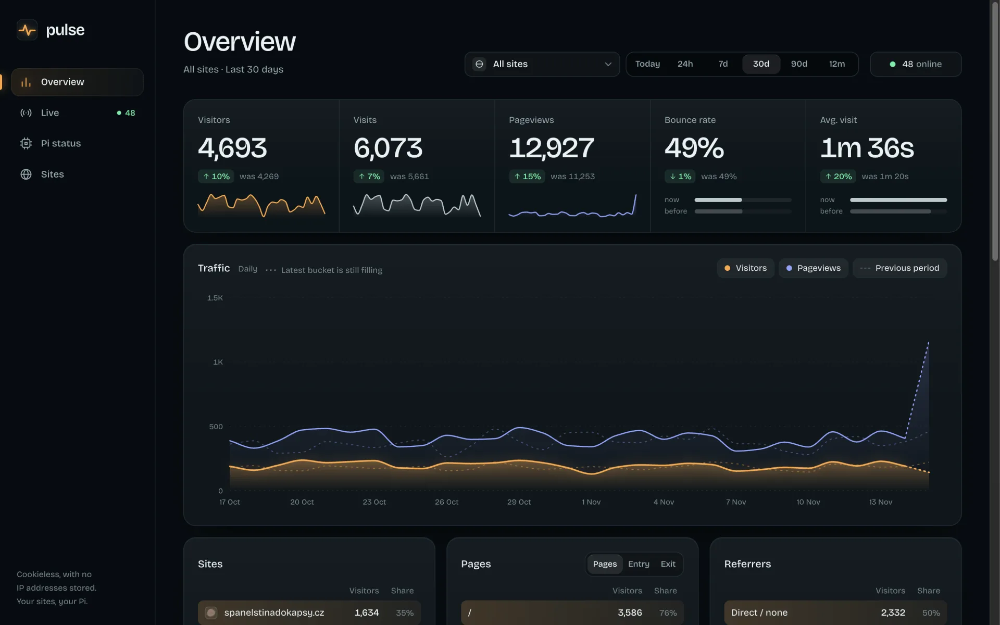
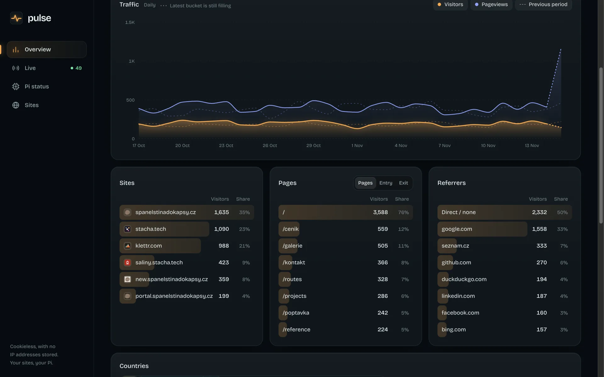
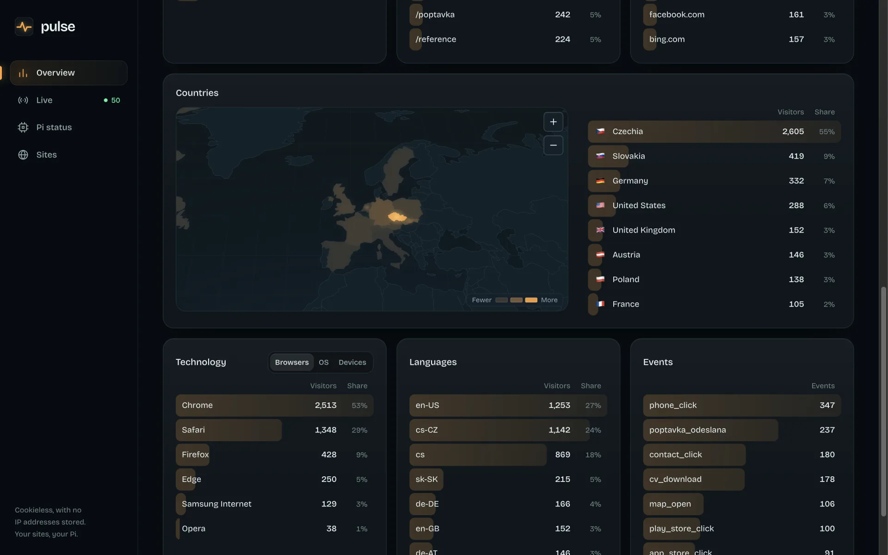
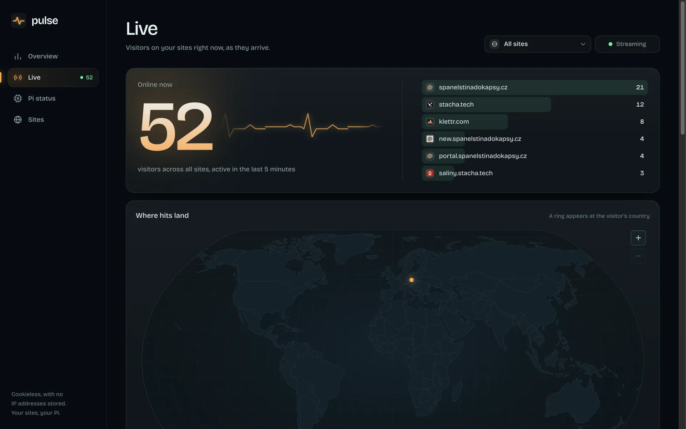
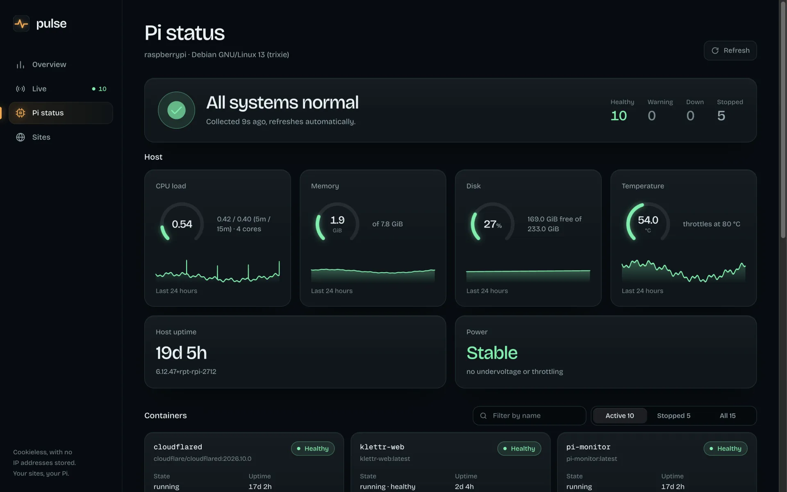
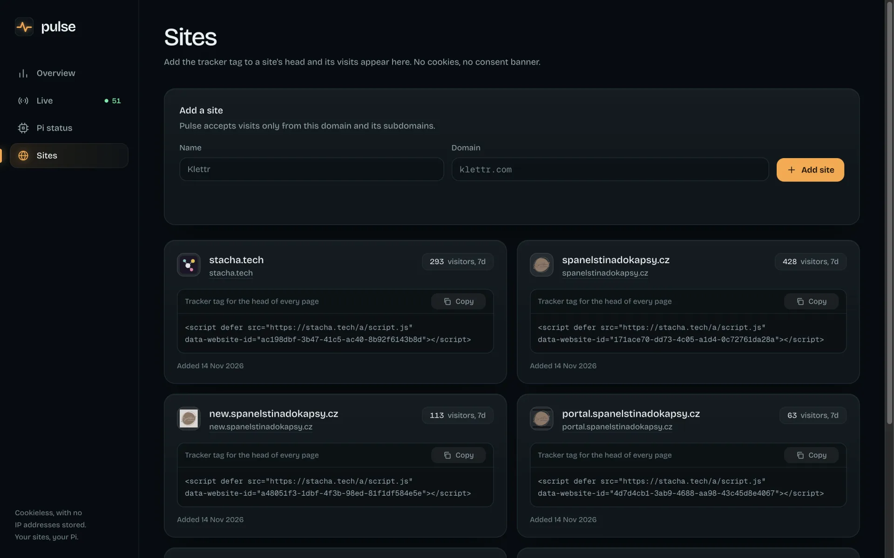
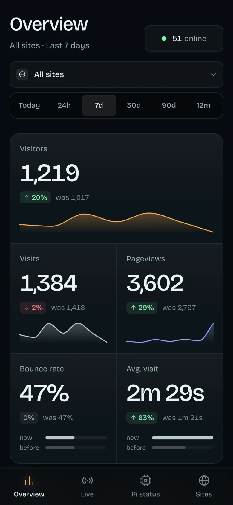
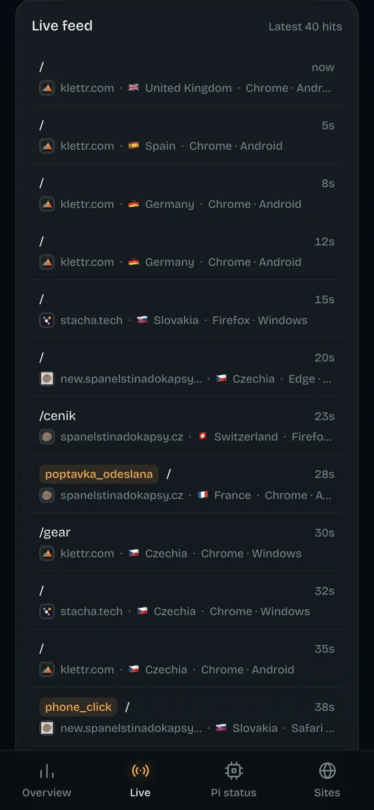

# Pulse

Self-hosted, cookieless web analytics and a Raspberry Pi health dashboard in one small app.
It runs my sites' statistics at `stats.stacha.tech` on a Raspberry Pi 5 and replaced Umami there.



- **Analytics without a consent banner.** No cookies, nothing written to the visitor's device, no IP
  address stored. The tracker is about 3 kB and drop-in compatible with Umami's script tag.
- **Live view.** Visitors online right now, hits landing on a world map and sliding into a feed (Server-Sent Events).
- **Pi status.** CPU, memory, disk, temperature, power and every Docker container, with 24-hour history.
- **One container.** .NET 11 minimal API, SQLite, Angular 22 dashboard. About 100 MB of RAM on the Pi.

## Screenshots

| | |
|---|---|
|  |  |
|  |  |
|  |   |

Screenshots show synthetic demo data.

## Privacy

- No cookies and no storage writes. The tracker only *reads* the opt-out key `localStorage['umami.disabled']`.
- No IP address is stored or logged. A visitor is the first 8 bytes of SHA-256(monthly salt ‖ site ‖ IP ‖ user agent).
  The salt of the previous month is deleted (and overwritten on disk), so old ids can't be recomputed and
  visitors can't be linked across sites or months.
- Only the path of a URL is stored, never its query string or hash. Referrers are reduced to a host name.
  Page titles and event properties are not stored.
- Country comes from Cloudflare's `CF-IPCountry` header; there is no GeoIP database.
- Events older than 25 months are deleted daily.

## How it works

```
site page ── <script defer src="https://stacha.tech/a/script.js" data-website-id="…">
   │  POST /a/api/send  (Umami-compatible JSON)
   ▼
reverse proxy (exact paths, per-IP rate limit, 16 kB body)
   ▼
pulse ── ASP.NET Core 11 minimal API ── SQLite (/data/pulse.db, WAL)
   │      └─ /status: the Pi's health snapshots (bind-mounted JSON)
   ▼
dashboard at stats.stacha.tech, behind Cloudflare Access
(the API also validates the Access JWT itself and refuses to start without it)
```

- **Tracker** (`tracker/script.js`): plain ES2017, no build step. It supports `data-website-id`,
  `data-domains`, `data-exclude-search`, `data-exclude-hash`, `data-do-not-track`, `data-before-send` and
  `data-tag`, follows SPA navigation, and offers `window.umami.track(name, data)`.
- **Collector and API** (`src/Pulse.Api`): ingestion with a bot filter and per-site hostname checks,
  a global rate limit, visits split after 30 minutes, time-zone and DST-correct periods, breakdowns,
  live SSE, and a site-icon proxy (public addresses only).
- **Dashboard** (`web/`): Angular 22, zoneless and signals, Tailwind 4, hand-drawn SVG charts,
  a zoomable `d3-geo` map. It works from a 360 px phone to a 2560 px screen, by mouse, touch and keyboard,
  and respects reduced motion.

Design, privacy model and API contract: [docs/DESIGN.md](docs/DESIGN.md). Deployment on the Pi: [docs/DEPLOY.md](docs/DEPLOY.md).

## Add a site

Sites → *Add a site* in the dashboard, then put the tag into the site's `<head>`:

```html
<script defer src="https://stacha.tech/a/script.js" data-website-id="…"></script>
```

Allow `script-src` and `connect-src` for the tracker's origin in the site's CSP. Custom events:
`window.umami?.track('signup', { plan: 'pro' })` (event properties are accepted but not stored).

## Develop

```bash
export PATH="$HOME/.dotnet:$PATH" DOTNET_ROOT="$HOME/.dotnet"   # .NET SDK 11

# API on :5190 with synthetic demo data (Development only), auth off
cd src/Pulse.Api
export Pulse__DbPath=/tmp/pulse-dev.db Pulse__Auth__Disabled=true
dotnet run -- seed-demo --days 120 --reset
dotnet run -- seed-demo --live          # API + a synthetic hit every few seconds

# dashboard on :4290, proxying /api and /script.js to :5190
cd web && pnpm install && pnpm start     # or `pnpm start:mock`, no backend needed

# tests
dotnet test                              # backend
(cd tracker && pnpm install && pnpm test)
(cd web && pnpm test)
```

The production image (`Dockerfile`) builds the dashboard, publishes the API and copies the tracker:
`docker buildx build --platform linux/arm64 -t pulse:latest .`
